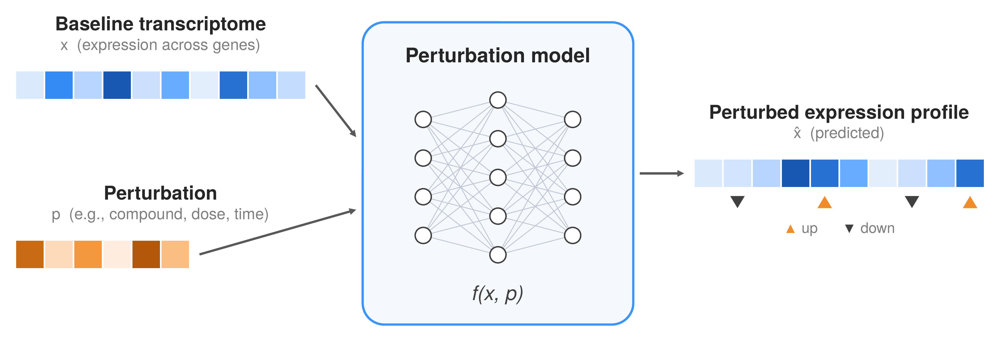
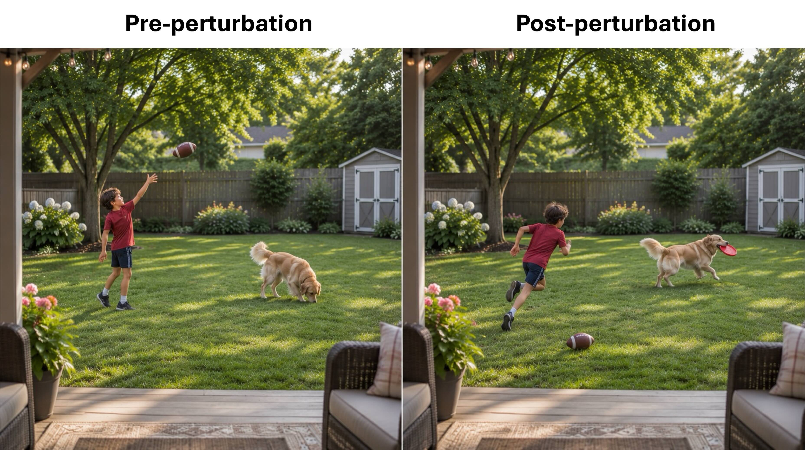

_THIS POST IS CURRENTLY UNDER CONSTRUCTION_

## Introduction

The dream of creating an _in silico_ model capable of predicting how a biological cell will respond to a provided stimulus is not new. The idea to predict cell behavior with mathematics and computation goes back [at least to the 1950's](https://pmc.ncbi.nlm.nih.gov/articles/PMC1392413/) and has continued to exist as a grand ambition in the field of computational biology. As our understanding of molecular biology grew through the decades, and as we learned more about the many thousands of species of molecules that play a role in the molecular biology of the cell, many dreamed of and devised early computational models that sought to simulate the cell at the level of individual molecules (e.g., [E-Cell](https://doi.org/10.1093/bioinformatics/15.1.72) and XXXXXXXX). However, despite our ability to measure cells with ever-increasing resolution, and despite the _drastic_ increases in the amount of data we could generate (and have generated), our ability to generate data has so far exceeded our ability to _model_ it. 

However, within the last several years, the field of machine learning matured and the promise of this technology has grown so large that we cannot help but to pursue the possibility that perhaps _it_ holds the key to true predictive biology. Perhaps, instead of simulating each molecule within the cell, we instead teach a powerful machine learning algorithm how cells respond to stimuli by simply showing it enough training examples. Indeed, this vision is gaining considerable momentum with substantial investment from both industry and philanthropy. A number of companies have been formed with this vision and are pursuing it with vigor, including my own, [Cellular Intelligence](https://www.cellularintelligence.com). Recently, the Department of Energy, Google, and Meta have [invested $1.8 billion](https://biohub.org/news/virtual-biology-initiative-expansion/) towards the goal of training virtual cell models with AI.

A common, general formulation the virtual cell modeling task is that, given a high-dimensional bimolecular measurement, most commonly a [transcriptome](https://en.wikipedia.org/wiki/Transcriptome) as represented by a gene expression vector, $x$, and a perturbation, $p$, we seek to predict how that measurement will change in response to the perturbation. That is, to predict $x'$, the resultant gene expression profile after $p$ is applied:

 

 

Here, $x$ is a vector representing gene expression across thousands of genes in the human genome (up to ~20k protein coding genes, though it is common practice to restrict to a smaller set of highly varying genes). $p$ is a vector representation for a perturbation such as a gene knockout or a chemical compound. 

For those working in this space, such as myself, I feel great optimism towards this goal, but it is coupled with a healthy dose of scientific humility. On the one hand, many of the pieces seem to be in place: we have powerful learning algorithms, access to enormous computational resources, and the ability to generate high-throughput molecular measurements of perturbed cells. On the other hand, biology is dizzyingly complex, and there is debate in the field around exactly how much data will be required, what modalities will be required, and what variables must be accounted for in order to train accurate, and useful predictive models of how cells respond to perturbations. 

In this blog post, I will present an analogy of the perturbation modeling task that I feel captures, to some loose degree, the challenge that we face with this task and that I think may even hold some clue on to how to approach it (or at the very least, enable better intuition for what approaches the community is currently pursuing). **This analogy frames the cell perturbation modeling task not as predicting the transcriptome of a cell that has been perturbed, but instead, as the task of predicting how the image of a backyard (yes, a backyard behind a house!) would change if you "perturbed" the scene with some kind of action (like throwing a frisbee into the yard).** I will drawn an analogy not only between this task and the cell perturbation modeling task, but also an analogy between various aspects of this task including the challenges of batch effects between samples, the context-specificity of cellular response to perturbation, and the challenges in reproducing perturbations between experiments. Through this analogy, I will seek to argue for a high-level mindset shift in the field towards our approach to this task.

Please note, the opinions expressed in this article are my own and not reflective of those held by my employer.

## An analogy: Perturbing a backyard

Gene expression profiles are hard to intuit. They are high-dimensional vectors that, unlike images or text, are difficult for a human to make sense of without a fairly rigorous analysis that cross-references patterns of expression seen in the gene expression profile with known biology of cell phenotype and function. For this reason, I personally find it difficult to intuitively reason about the perturbation-response prediction task without diving into deep data-driven analyses that feel somewhat devoid of real intuition. 

In fact, I'd argue that this is a problem that so far is limiting progress. Take for example, the recent observation that simple baseline machine learning models may in fact outperform large foundation models in modeling transcriptomics data. To drive the point further, even this observation is contested! The fact that the community cannot even agree on whether one model outperforms another is, I think, less of a problem in applications of machine learning that lie closer to human intuition such as computer vision and language model where a person can literally see or read the objects that are being modeled. 

With this in mind, I propose an analogy of the perturbation modeling task to a more intuitive task that lies in the macro-world in which we live in and see: **"backyard perturbation"**. 

The backyard perturbation task goes as follows:

* **Given:** The image of a scene of a backyard behind a house. Maybe there's a dog in the backyard. Perhaps a kid playing in the backyard.
* **Perturb the backyard:** Perform some action that "perturbs" the backyard. For example, throw a frisbee in the yard. Have an ice cream struck pull up in front of the house. Etc.
* **Task:** Predict the image of the backyard 1 minute after the perturbation.

An example of a training sample is seen shown below:

 

 

Notice how after the frisbee is thrown into the yard, the dog has captured the frisbee. The boy is running after the dog and has dropped the football he was playing with. This is a snapshot of what is occurring as the "backyard" responded to the frisbee being thrown. Our task is to train a machine learning model that, given the image on the left, would have produced the image on the right.

Not all backyards look like this, however, and a boy and dog may not respond in quite this way each time. Below are two more examples, similar to this one.

